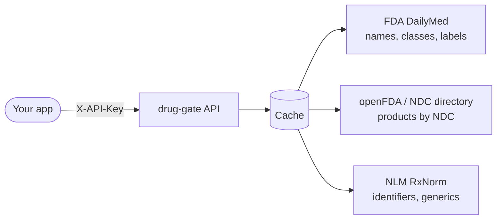

# How it works

You talk to one API, **drug-gate**. Behind it, a caching service collects data
from government sources so your requests are fast and don't depend on those
sources being up at that moment.

## Where each kind of data comes from

| Data | Source | How fresh |
|---|---|---|
| Drug names, drug classes | FDA DailyMed | Refreshed every 6 hours |
| Products by NDC | FDA NDC directory | Reloaded daily; cached about an hour |
| Product labels (SPL), label sections, interactions | FDA DailyMed | Fetched on first request, then cached |
| RxNorm IDs, generics, related concepts | NLM RxNorm | Cached for days (changes rarely) |

## Things worth knowing

- **Names are fuzzy, IDs are exact.** A name like "lipitor" can match many
  products. When you need one specific product, carry an ID: an NDC, an RxCUI,
  or a label's set ID. See the [Glossary](../reference/glossary.md).
- **One label speaks for a drug.** The info card and the interaction check use
  the *most recently published* label for a name. Different manufacturers' labels
  for the same drug can differ.
- **Interactions come from label text.** The checker looks for each drug's name
  in the other drug's label sections. It's a reading aid, not a clinical
  decision tool.
- **First requests can be slower.** If nobody has asked for an item recently, the
  API fetches it from the source, typically under a second. Repeats are served
  from cache.
- **If a source is down,** cached data is still served where possible. Otherwise
  you get `502` ([Errors](../reference/errors.md)).

For the full picture, the three services and how they fit together, see
**[System → How the system fits together](../system/index.md)**.
