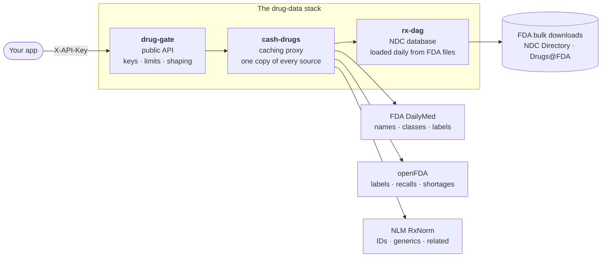

# How the system fits together

The API you call is the front of three services. Each has one job.

| Service | Job | Who calls it |
|---|---|---|
| [**drug-gate**](drug-gate.md) | The public REST API: API keys, rate limits, CORS, input normalization, and turning raw source data into clean JSON | You |
| [**cash-drugs**](cash-drugs.md) | An internal caching proxy: fetches every government API once, stores it, refreshes it on a schedule, and keeps serving it when a source is down | drug-gate (internal only) |
| [**rx-dag**](rx-dag.md) | An internal NDC database: downloads the FDA's full NDC Directory and Drugs@FDA files every night and serves fast NDC lookups and search | cash-drugs (internal only) |

Only drug-gate is reachable from the internet. cash-drugs and rx-dag have no public address.

## A request, step by step

Take `GET /v1/drugs/info?ndc=0069-3150` (drug info for a Lipitor package):

1. **drug-gate checks the key** (`X-API-Key`), the key's per-minute limit and the caller's origin.
2. **drug-gate normalizes the NDC** (`0069-3150` and `00069-3150` are the same product) and looks in its own cache.
3. On a miss it asks **cash-drugs** for the product. cash-drugs answers from its store, or asks **rx-dag**, which looks the NDC up in tonight's copy of the FDA NDC Directory. The answer is the generic name, *atorvastatin calcium*.
4. drug-gate asks cash-drugs for the **newest FDA label** for that name and its XML. cash-drugs answers from its store, or fetches from **DailyMed** and keeps a copy.
5. drug-gate **parses the label** into interactions, contraindications, warnings and adverse reactions, caches the result, and returns JSON.

A repeat of the same request is answered from drug-gate's cache in a few milliseconds. The first one usually takes well under a second.

## Why three services

- **Government APIs are slow, rate-limited and sometimes down.** cash-drugs absorbs that: it calls each source once, paces itself to stay under rate limits, and keeps serving its last good copy during an outage.
- **The NDC Directory is too big and too important to query live.** rx-dag keeps the whole thing in a local database, so NDC lookups don't depend on openFDA.
- **The public API should be small and stable.** drug-gate is the only thing with keys, limits and a versioned contract (`/v1`); the plumbing behind it can change freely.

## Read more

- [drug-gate](drug-gate.md) · [cash-drugs](cash-drugs.md) · [rx-dag](rx-dag.md)
- [Data freshness](data-freshness.md): how old each kind of data can be.
- [Reliability](reliability.md): what happens when a source fails.
